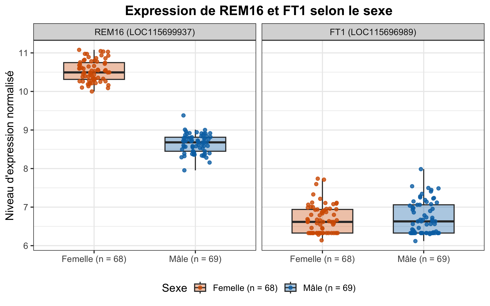

# Devoir 1 — BVG 7003 | Outil d'analyse transcriptomique

## Sommaire

- [Aperçu](#aperçu)
- [Installation de l'outil](#installation)
- [Exécution de l'outil](#exécution)
- [Structure du dépôt](#structure-du-dépôt)
- [Résultats](#résultats)

## Aperçu
Ce dépôt contient un outil d'analyse de l'expression génique normalisée de 138 plantes de *Cannabis sativa* (137 retenues pour l'analyse). Il compare l'expression de deux gènes, **REM16** (LOC115699937) et **FT1** (LOC115696989), entre plantes mâles et femelles, afin d'évaluer leur potentiel comme marqueurs permettant le sexage des plantes.

Le cœur de l'outil est un script R : [`code/run_analysis.R`](code/run_analysis.R).

Le script permet d'analyser le fichier de données transcriptomiques [`data/2_Data_RNASeq_Cannabis_Sex.csv`](data/2_Data_RNASeq_Cannabis_Sex.csv).

Le script produit trois graphiques :

- Boxplot de l'expression de REM16 selon le sexe : [`figures/REM16_boxplot_by_sex.png`](figures/REM16_boxplot_by_sex.png)
- Boxplot de l'expression de FT1 selon le sexe : [`figures/FT1_boxplot_by_sex.png`](figures/FT1_boxplot_by_sex.png)
- Boxplot de l'expression de REM16 et FT1 selon le sexe : [`figures/REM16_FT1_combined_by_sex.png`](figures/REM16_FT1_combined_by_sex.png)

Les versions des paquets sont fixées avec le paquet R `renv` et tous les chemins sont relatifs à la racine du projet, pour que l'analyse soit reproductible pour n'importe quel utilisateur ayant cloné le dépôt depuis **GitHub**.

## Installation

**Prérequis**

- [R](https://cran.r-project.org/) (version 4.5.3, celle fixée dans `renv.lock`)
- [Git](https://git-scm.com/downloads)
- [RStudio Desktop](https://posit.co/download/rstudio-desktop/) (recommandé sous Windows)

**1. Obtenir le dépôt**

```bash
git clone https://github.com/simonboudreaupineault/devoir1_BVG7003.git
cd devoir1_BVG7003
```

**2. Installer les paquets R**

Les versions exactes des paquets nécessaires au fonctionnement de l'outil sont dans `renv.lock`. Voici la marche à suivre pour les installer avant d'exécuter l'outil :

*macOS et Linux* — dans un terminal, depuis la racine du dépôt :

```bash
Rscript -e 'renv::restore(prompt = FALSE)'
```

*Windows* — `Rscript` est souvent inaccessible depuis le terminal, si c'est le cas passer par RStudio :

1. Ouvrir `devoir1.Rproj` dans RStudio.
2. Dans la console de RStudio, exécuter `renv::restore()` et répondre `y` pour confirmer.

## Exécution

Le script doit être lancé depuis la racine du dépôt (ou via `devoir1.Rproj`).

*macOS et Linux* — dans un terminal, depuis la racine du dépôt :

```bash
Rscript code/run_analysis.R
```

*Windows (via RStudio)* :

1. Ouvrir `devoir1.Rproj`.
2. Ouvrir `code/run_analysis.R`.
3. Cliquer sur *Source* (en haut à droite de l'éditeur).

Les dossiers `figures/` et `results/` sont créés s'ils n'existent pas; les fichiers existants sont remplacés.

## Structure du dépôt

```
devoir1_BVG7003/
├── code/
│   └── run_analysis.R                  # script d'analyse
├── data/
│   └── 2_Data_RNASeq_Cannabis_Sex.csv  # fichier de données analysé
├── figures/                            # boxplots générés par le script
│   ├── REM16_boxplot_by_sex.png
│   ├── FT1_boxplot_by_sex.png
│   └── REM16_FT1_combined_by_sex.png
├── results/
│   └── REM16_FT1_expression_long.csv   # données filtrées pour REM16 et FT1
├── Question_1/                         # livrables réalisés en classe
├── Question_2/
├── Question_4/
├── renv/                               # configuration de renv pour la reproductibilité
├── renv.lock                           # versions exactes des paquets R
├── .Rprofile                           # active renv à l'ouverture du projet
├── devoir1.Rproj                       # projet RStudio (définit la racine)
├── CLAUDE.md                           # consignes données à l'assistant IA
└── README.md
```

## Résultats



**Figure combinée.** Niveau d'expression normalisé de REM16 (gauche) et de FT1 (droite) chez les plantes femelles (XX, orange, n = 68) et mâles (XY, bleu, n = 69). Chaque point est une plante; les boîtes indiquent la médiane et l'écart interquartile. Les deux panneaux partagent la même échelle Y. L'unité de normalisation des données fournies n'est pas connue. La plante `011_XX` est exclue des deux gènes, car sa valeur de FT1 est manquante.

Les figures par gène sont dans [`figures/REM16_boxplot_by_sex.png`](figures/REM16_boxplot_by_sex.png) et [`figures/FT1_boxplot_by_sex.png`](figures/FT1_boxplot_by_sex.png). Les valeurs exactes représentées sont dans [`results/REM16_FT1_expression_long.csv`](results/REM16_FT1_expression_long.csv).
