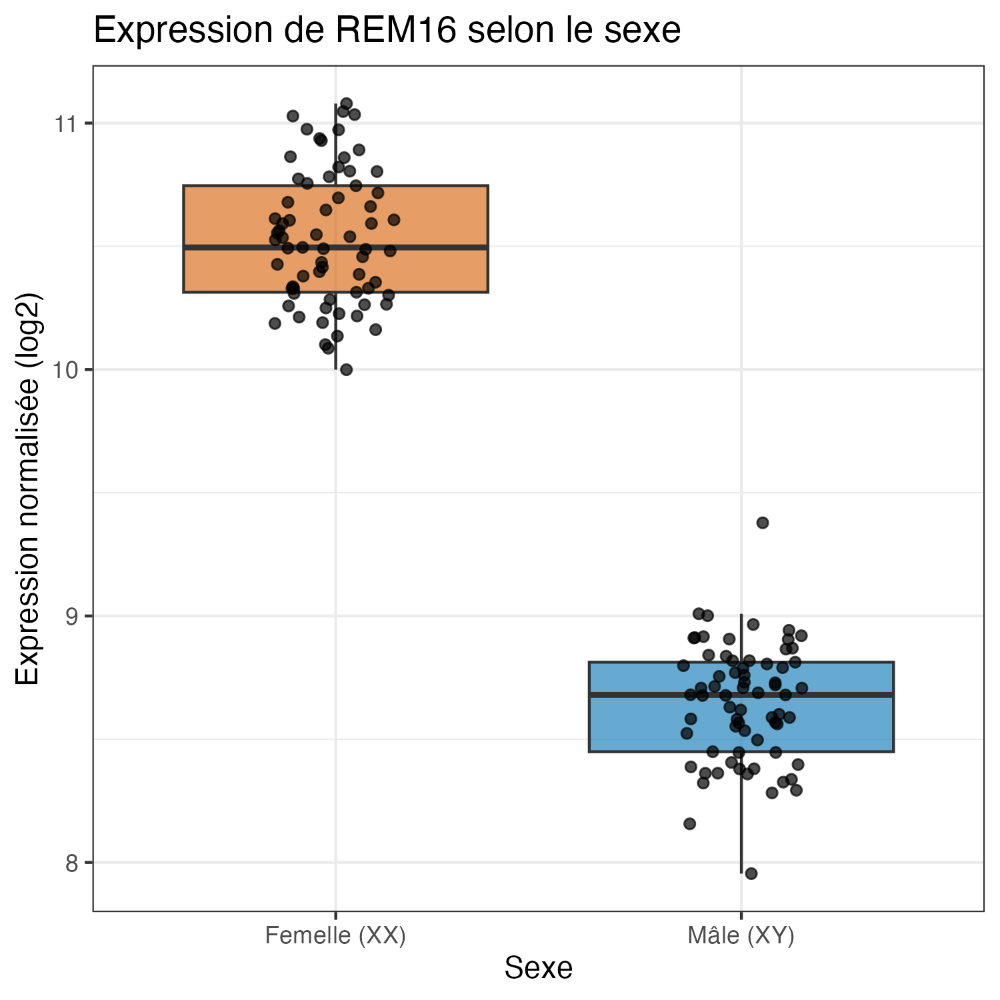
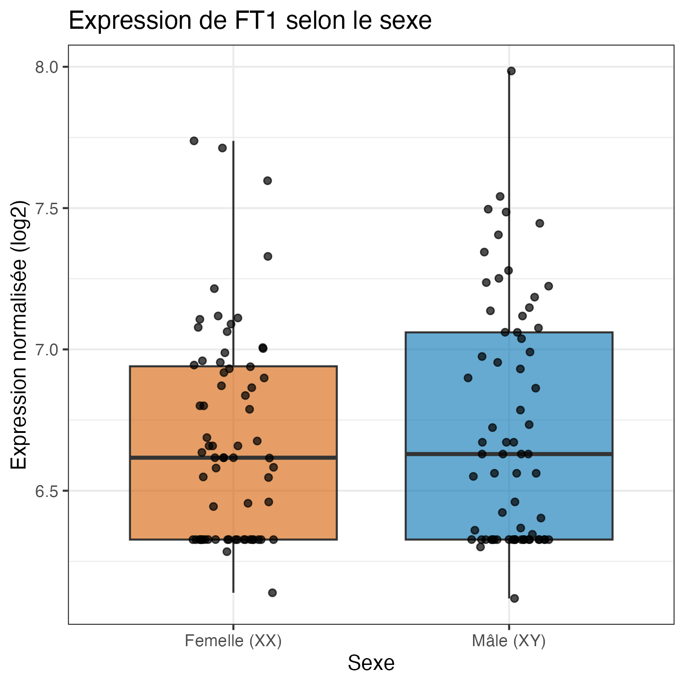
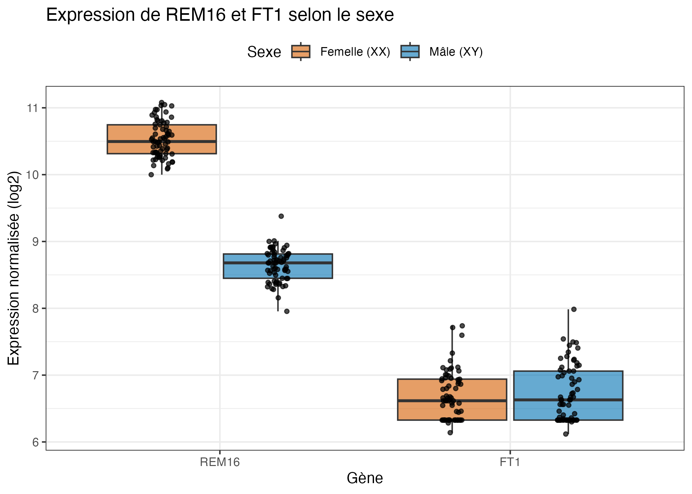

```{r setup, include = FALSE}
knitr::opts_knit$set(root.dir = "..")
knitr::opts_chunk$set(echo = TRUE, message = FALSE, warning = FALSE)
```

## Données

Les données proviennent de `files/2_Data_RNASeq_Cannabis_Sex.csv` : l'expression
de 20 500 gènes chez 138 plants de cannabis (69 femelles XX et 69 mâles XY).
Les deux gènes sont trouvés par leur identifiant de locus :

| Gène  | Identifiant de locus |
|-------|----------------------|
| REM16 | LOC115699937         |
| FT1   | LOC115696989         |

## Extraction (Python)

Le script `question_3/extraire_expression.py` extrait l'expression des deux gènes
et l'écrit dans `question_3/expression_REM16_FT1.csv` (une ligne par échantillon).

```{bash, eval = FALSE}
python3 question_3/extraire_expression.py
```

## Figures (R)

Le script `question_3/figures_expression.R` produit les trois figures. L'expression
est présentée sur une échelle log2 normalisée.

```{r}
source("question_3/figures_expression.R")
```

### REM16 selon le sexe

{width=60%}

### FT1 selon le sexe

{width=60%}

### Comparaison des deux gènes

{width=80%}

## Médianes par sexe

```{r}
aggregate(Expression ~ Gene + Sexe, data = long, FUN = median)
```

## Interprétation

- **REM16** est nettement plus exprimé chez les femelles (XX) que chez les mâles (XY),
  et les deux groupes se chevauchent à peine.
- **FT1** a une expression semblable chez les deux sexes. Plusieurs échantillons sont
  au même niveau plancher (~6,33), ce qui suggère une expression très faible.
